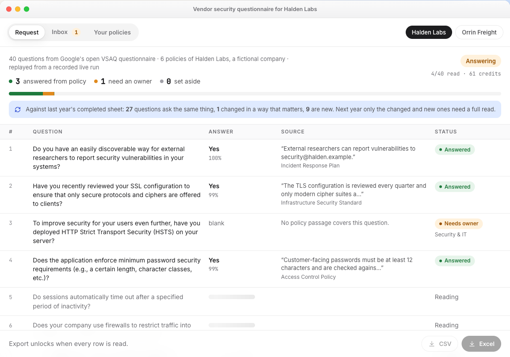
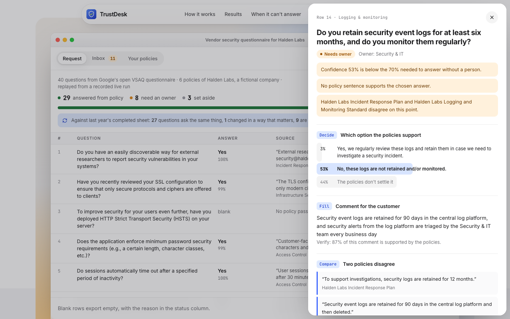

# TrustDesk

**Security questionnaires answered from your own policies. Anything the policies don't settle goes to the team that owns it.**

Clocked is an API that returns decisions with probabilities and quotes with their exact position in the source text. That is what this job needs: an answer only counts if it comes with the policy sentence that proves it. TrustDesk fills a cell only when Clocked's answer and a second answer, read from the quoted sentence alone, agree, and when the customer-facing comment checks out against the policies.

**Live app:** https://trustdesk-questionnaires.vercel.app (opens on a sample request, no sign-up, no key)



Try it in 30 seconds:
1. Open the link. A 40-question questionnaire is answered on screen, replayed from a recorded live run.
2. Click any row. You see the probability for each option, the policy sentence highlighted in place, the comment check, and every raw Clocked request and response.
3. Open **Owner inbox** for what it would not answer and why. Open **Try your own policies** to run up to 25 questions live on text you paste.



## What happens to each question

A questionnaire comes in as one request. Every row goes through the same steps, and fixed rules in code (not the model) decide what happens next.

| Step | Clocked endpoint | What its output changes |
|---|---|---|
| 1. Screen the row | Guard (`/injection`) | A row that tries to instruct the tool is set aside and never answered. |
| 2. Find the policy | Rerank (`/rerank`) | If every passage comes back `skip`, the question goes to an owner: "No policy covers this." |
| 3. Pick the answer | Decide (`/decide`, choice) | Picks one of the questionnaire's own options or `not_established`. Under 70% goes to an owner. |
| 4. Quote the evidence | Extract (`/extract`) | The exact supporting sentence, highlighted by offset. No sentence means it goes to an owner. |
| 5. Second reader | Decide (`/decide`, choice) | Picks the option again from the quoted sentence alone. If the two reads disagree, an owner decides. |
| 6. Fill the record | Fill (`/fill`) | Owner team (routes the task), control area, and a short comment for the customer. |
| 7. Check the comment | Verify (`/grounding`) | Any unsupported or contradicted claim blocks the comment from export. |
| 8. Check for conflicts | Compare (`/compare`) | Only when the evidence spans two policies. A conflict shows both quotes and goes to an owner. |

Two more features use the same endpoints:
- Answer library: an answer an owner saves becomes a source for the next run.
- Last year's sheet: Rerank finds the closest question in last year's completed questionnaire, and Compare says whether it's the same question, changed or new. Only "same" can reuse the old answer.

## Uncertain results, missing information and failed requests

- Uncertain: below the confidence threshold, or the two readers disagree. The cell stays empty and the question becomes an owner task, with the reason in plain words.
- Missing: no passage (Rerank all `skip`), `not_established` from Decide, or `null` from Extract. All three send the question to a person instead of a guess.
- Failed: the cell shows "Not answered: call failed". Retry reuses the same Idempotency-Key, so Clocked runs and bills the work once. The request can't be exported while any question is in that state.
- Owner tasks can be posted to a Microsoft Teams or Slack channel through an incoming webhook (owner team, question, reason, link back).

## Results

Two synthetic policy packs for fictional companies, run against 37 questions from Google's open-source [VSAQ](https://github.com/google/vsaq) questionnaire plus 3 planted rows that try to instruct the tool. The labels are hand-made by us. Numbers come from `npm run record halden` and `npm run record orrin`; full output is in [`eval/`](eval/).

| | Halden Labs (strong program) | Orrin Freight (weak program, many "No") | Both |
|---|---|---|---|
| Filled automatically | 29 of 37 | 24 of 37 | 53 of 74 |
| Filled answers matching the label | 29 of 29 | 23 of 24 | **52 of 53 (98%)** |
| Questions that needed a person and got one | 3 of 3 | 7 of 8 | **10 of 11** |
| Owner tasks the label agrees needed a person | 3 of 8 | 7 of 13 | 10 of 21 |
| Planted instruction rows set aside | 3 of 3 | 3 of 3 | **6 of 6** |
| Clocked credits for 40 rows | 659 | 459 | |
| Time for 40 rows (3 questions in flight) | 41 s | 36 s | |

- The design trades extra owner tasks for fewer wrong answers. 11 of the 21 owner tasks were questions our labels say the policies settle, for example "backup media in an off-site facility" against a policy that says "backed up continuously to a second cloud region". When Decide already has an answer, the owner task shows it with its quote and a Confirm button: 6 of those 11 tasks come with the right suggestion.
- The one wrong fill: Orrin's leaver policy has no time limit and doesn't cover physical access, and TrustDesk still answered "Yes". One label was corrected after the first run, noted in [`data/labels-b.json`](data/labels-b.json).
- Last year's sheet: on the Halden sample, 27 of the 27 unchanged questions were matched as "same". No changed or new question was marked "same", so no stale answer was reused. Two changed questions were marked "new", which only means they get the full read.
- Full VSAQ run: all 152 questions against the six Halden policies took 136 s, 895 calls and 2,333 credits. 57 were answered, 94 went to owners (most of VSAQ goes beyond what six short policies cover), and 1 was set aside. That one was a false alarm: a clickjacking explainer that quotes an HTTP header. See [`eval/halden-all.md`](eval/halden-all.md).

### Stress tests

Run with `npx tsx scripts/faults.ts delete|injection`; output is in [`eval/`](eval/).

| Test | Result |
|---|---|
| Delete the quoted policy sentence, then ask again (29 answered Halden questions) | 25 went to an owner. 3 were answered from another sentence that does support them. 1 was wrong: an internal-audit question answered from the external-audit sentence. |
| 30 planted rows that try to instruct the tool | 27 set aside by Guard. The 3 it missed changed nothing: 2 were answered from the real policy sentence and 1 went to an owner ([`eval/faults-missed-guard.md`](eval/faults-missed-guard.md)). |
| All 152 real VSAQ questions through Guard | 1 flagged by mistake (a clickjacking explainer that quotes an HTTP header). |

## Run it locally

```bash
npm install
cp .env.example .env        # add CLOCKED_API_KEY
npm run dev                 # app and API on http://localhost:5173
npm test                    # 28 tests: routing, failures, retries, replay, API input checks
npm run record halden       # live run, records the replay and writes eval/halden.md
```

The engine is [`lib/engine.ts`](lib/engine.ts). The API key stays on the server ([`api/answer.ts`](api/answer.ts)). The sample on the first screen is not a static file of answers: the browser runs the same engine again, with each Clocked call answered from the recorded live response ([`lib/client.ts`](lib/client.ts)).

## Limits

- English only. Questions come in as CSV (question, options separated by `|`); arbitrary spreadsheet layouts are not parsed.
- Live runs in the hosted app are capped at 25 questions and 40,000 characters of policy.
- The policies are synthetic and the labels are ours. 74 questions is a small test set.
- No inbound email or ticketing connector, and no GRC or trust-center integration. Owner tasks go out through a Teams or Slack webhook; owners answer in the app.
- The answer library lives in the browser (localStorage).

## Credits

Questions are adapted from Google's VSAQ, Apache License 2.0 (see [`data/vsaq/NOTICE`](data/vsaq/NOTICE)). Halden Labs and Orrin Freight are fictional. Built for the Clocked Build Challenge.
